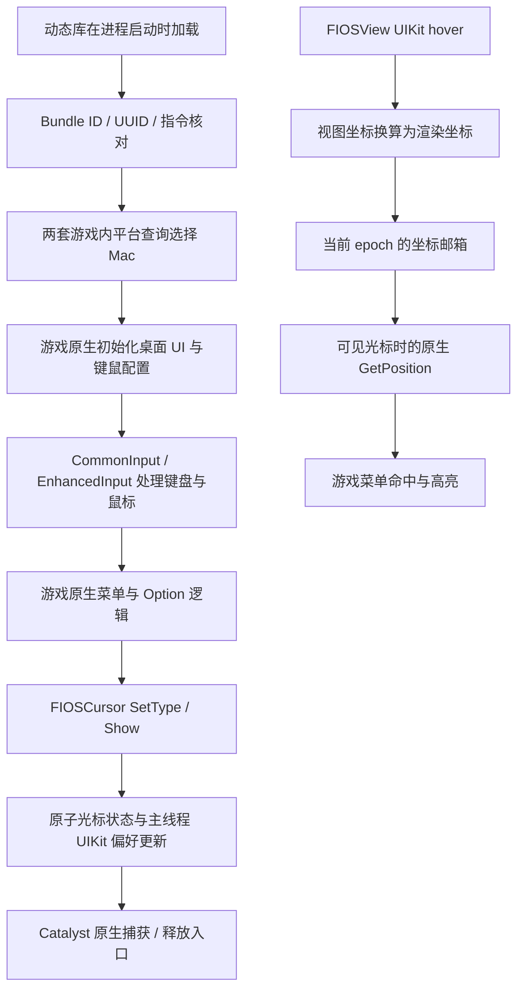

# NTEDesktopMode：原理与维护指南（ 0.5.5 正式版）

NTEDesktopMode 是用于 PlayCover 中《异环》（Neverness to Everness）iOS 版本的进程内动态库。它启用游戏已有的桌面平台判断和键鼠输入配置，并补齐 iOS / Mac Catalyst 输入后端与桌面窗口之间的光标接口。

**历史可用基线：0.5.4。2026-10-31，用户实测反馈“目前所有功能都 ok 了”。** 这覆盖本轮关注的键鼠操作、桌面 UI、菜单鼠标释放、Option 临时释放及菜单鼠标交互。该结论来自用户实测；开发侧的独立检查、静态证据和具体实现分别记录于下文。没有把“独立测试通过”等同于“已自动完成游戏内测试”。

最初参考的 `libUnityDesktopMode.dylib` 提供了启用原生桌面输入的思路；本工程实际面对的是包含 `FIOSApplication`、`CommonInput`、`EnhancedInput` 的 Unreal Engine 目标程序，最终实现不依赖该 Unity 插件。

**0.5.5 更新（2026-10-31）：** 当前正式版位于 `outputs/NTEDesktopMode-release`，沿用用户已确认修复地图拖动问题的 `0.5.5-indirect.1`，并默认关闭日志、保留日志源码。[第 16 节](#indirect-input-fix)补充重复触摸输入的原因、修复实现和维护要求。第 1—15 节保留 0.5.4 基线的设计与验证记录。

## 1. 支持范围与可复现基线

| 项目 | 当前基线 |
| --- | --- |
| 插件 | `libNTEDesktopMode.dylib`，0.5.4 |
| 游戏 Bundle ID | `com.pwrd.yh.ios` |
| 游戏版本 / build | iOS 1.4.0 / 0.0.27 |
| 主程序 | `HTGame-IOS-Shipping` |
| 架构 / 构建目标 | arm64 / `arm64-apple-ios15.0-macabi` |
| 主程序 Mach-O UUID | `79d3fd53-950b-3047-884f-4aa4bfb38364` |
| 已核对主程序 SHA-256 | `1c3df7b0f28993a41da84c0a0b74979a836d19e4f49f955b0acc6234e0f8ee17` |
| 0.5.4 交付 dylib SHA-256 | `c5c4e4ea6784d5f4339beee99b1cd292746e16b5ae777d345142321da126b74b` |
| 宿主接口调查环境 | 本机 macOS 27.2，build 26B123 |
| 开发侧验证 | 487 项独立检查、64 处目标指令签名、反射/虚表核对、签名和独立宿主动态加载 |

主程序哈希对应**用户已经做过启动修复的本机文件**，不是未经修改的厂商安装包。运行时主要依据 Bundle ID、架构、UUID 和指令签名判断支持性；整个文件的 SHA-256 用于离线记录与验证，不是在每次启动时计算。

本工程目录：

```text
/Users/x1ngchuan/Downloads/playcover-ios-mac/outputs/NTEDesktopMode
```

本机游戏主程序，维护时只读分析：

```text
/Users/x1ngchuan/Library/Containers/io.playcover.PlayCover/Applications/com.pwrd.yh.ios.app/HTGame-IOS-Shipping
```

下文所有 `0x...` 游戏代码/全局地址，除明确标为对象字段或虚表槽偏移外，均指**相对主映像起点的偏移**。运行时地址为 `gBase + offset`，其中 `gBase` 来自主程序 Mach-O header，因此支持 ASLR。适配另一构建时，需要按 Mach-O segment 的 `vmaddr/fileoff` 重新核对，不能普遍把这些值直接当成文件偏移。

## 2. 整体设计

最终修复分为五层：

1. **平台识别**：在正常初始化前，让两套游戏内平台查询分别选择各自枚举中的 Mac 分支。
2. **原生输入配置**：允许 CommonInput 使用键鼠，保留游戏原生 EnhancedInput 动作、映射上下文和键位配置。
3. **原生光标状态**：观察游戏自己的 `FIOSCursor::SetType/Show`，把显隐决定转换为窗口捕获偏好。
4. **窗口捕获执行**：通知 UIKit，再通过 Catalyst 已有的宿主入口完成捕获/释放及系统记账。
5. **菜单绝对坐标**：把真实 UIKit hover 坐标交给原生光标位置查询，使桌面菜单能够正确命中选项。



按键绑定、按住 Option 的动作、Esc 打开菜单以及技能处理仍由游戏自身执行。插件的硬件回调包装器主要负责观察和原样转发；菜单坐标和窗口捕获则由明确的接口桥接补齐。

## 3. 源码导航

| 文件 | 责任与建议阅读顺序 |
| --- | --- |
| [NTEDesktopMode.mm](/Users/x1ngchuan/Downloads/playcover-ios-mac/outputs/NTEDesktopMode/src/NTEDesktopMode.mm) | 主入口、目标验证、输入修复、日志、原生光标接入、UIKit 协调。建议从 `StartPlugin()` 向前查对应函数。 |
| [MacPlatformPatch.h](/Users/x1ngchuan/Downloads/playcover-ios-mac/outputs/NTEDesktopMode/src/MacPlatformPatch.h) | 两组平台查询、指令编码、RX 页面准备/替换/核对及回退。 |
| [NativeCursorBridge.h](/Users/x1ngchuan/Downloads/playcover-ios-mac/outputs/NTEDesktopMode/src/NativeCursorBridge.h) | 原生光标对象/虚表常量、显隐状态机、完整虚表克隆。 |
| [HostCursorBridge.h](/Users/x1ngchuan/Downloads/playcover-ios-mac/outputs/NTEDesktopMode/src/HostCursorBridge.h) | Catalyst 宿主对象查找、方法 ABI/来源验证及原生捕获/释放调用。 |
| [NativeCursorPosition.h](/Users/x1ngchuan/Downloads/playcover-ios-mac/outputs/NTEDesktopMode/src/NativeCursorPosition.h) | 绝对坐标数据类型、比例换算、线程安全的坐标邮箱。 |
| [build.sh](/Users/x1ngchuan/Downloads/playcover-ios-mac/outputs/NTEDesktopMode/build.sh) | 编译并签名 dylib。 |
| [tests/run.sh](/Users/x1ngchuan/Downloads/playcover-ios-mac/outputs/NTEDesktopMode/tests/run.sh) | 构建签名测试映像，运行全部独立检查并验证产物签名。 |
| [VALIDATION.json](/Users/x1ngchuan/Downloads/playcover-ios-mac/outputs/NTEDesktopMode/VALIDATION.json) | 交付时的静态证据、独立测试结果、源码/产物哈希。它保留交付时状态，用户后续实测确认见本文开头。 |

## 4. 启动、线程与目标验证

### 4.1 启动顺序

`StartPlugin()` 是 dylib constructor，依次执行：

1. 检查主 Bundle ID；其他进程直接跳过。
2. 打开日志，读取 `config.plist`。
3. `GuardMainImage()` 验证 arm64 Mach-O、目标 UUID 和 64 处指令签名，设置 `gBase`。
4. **同步**执行 `ConfigureMacPlatform()` 与 `ConfigureUIPlatform()`。
5. 异步进入主线程，恢复已识别的窗口偏好覆盖、获取原生 application、订阅捕获/场景通知，并启动低频任务。

平台查询必须在构造阶段完成，才能影响游戏随后对配置、输入和 UI 的选择。延迟加载插件不会自动重做已经完成的原生初始化。

### 4.2 主线程与游戏线程

| 执行位置 | 工作 |
| --- | --- |
| 构造阶段 | 目标验证与两组平台查询补丁。 |
| UIKit 主线程 | GameController 观察器接入、application 获取、窗口偏好更新、宿主捕获、hover 坐标采集、焦点通知。 |
| UE 游戏线程 | 对象扫描、CommonInput 配置、EnhancedInput 修复、单个原生光标虚表接入。 |
| 相关原生回调线程 | 原样调用 setter/输入处理器，再发布原子状态或诊断计数；不在这里操作 UIKit 窗口。 |

`TimerTick()` 在首次延迟 10 秒后，每约 3 秒运行一次。它通过经过方法地址核对的 `FIOSAsyncTask::CreateTaskWithBlock:`（`0x10e8398`）向 UE 游戏线程提交任务；`gQueued` 阻止前一个任务未完成时继续堆积。

这个低频任务用于延迟初始化、重新接入观察器、输入状态维护与诊断。**光标显隐到窗口捕获的同步由原生 setter 事件驱动**，不是靠每 3 秒读控制器显隐位来决定是否锁鼠标。

### 4.3 对象与方法验证

主要检查包括：

- `ClassIsA()` 使用本构建的 `FStructBaseChain` 布局，支持子类身份判断。
- UObject 扫描排除默认对象、销毁对象与无效槽，核对对象索引。
- 需要跨诊断周期识别同一对象时，使用 `serial + index`，避免场景切换后地址复用。
- UObject 指针只在游戏线程的当前扫描内使用；UIKit 回调读取的是原子状态或坐标邮箱。
- `ReplaceOwnMethod()` 只替换精确类自身声明、IMP 未改变且 BOOL ABI 匹配的方法，避免把父类通用方法一起改掉。
- 光标对象要通过 application 所有权、原始虚表、全部槽、前缀字和字段范围验证。

## 5. 两套平台查询：键鼠与桌面 UI 的关键

### 5.1 为什么只打开键鼠支持还不够

早期只调整 CommonInput 的键鼠支持标志时，系统能收到部分输入，但游戏仍可能选中触屏 profile、过滤移动/视角绑定或继续选择移动 UI 模板。平台身份会影响更早的初始化选择。

本插件只改已经确认的**游戏内平台查询**。没有把全部系统平台 API 都伪装成 macOS，也没有把 iOS 渲染、着色器或资源平台整体切换成原生 Mac 版本。

### 5.2 第一组：EHTCommonPlatformType

位置：`MacPlatform::kQueries`。

| 查询 | 映像相对偏移 | 原值 | 目标值 |
| --- | --- | --- | --- |
| `GetCurrentPlatform` | `0xaa1b164` | 16，IOS | 2，Mac |
| `IsPC` | `0xaa1b16c` | 0 | 0 |
| `IsMac` | `0xaa1b174` | 0 | 1 |
| `IsDesktop` | `0xaa1b17c` | 0 | 1 |
| `IsMobilePlatform` | `0xaa1b1f4` | 1 | 0 |

`IsPC` 保持 false：这里选择的是 Mac 分支，不能把“桌面”直接理解成所有 PC/Windows 查询都应返回 true。

这组查询影响游戏的桌面输入选择。0.5.0 之后，用户已确认 WASD、视角和攻击生效；日志也曾确认原生 profile 为 `Input.MouseAndKeyboard`，六项移动/视角活动绑定完整。

### 5.3 第二组：EHTPlatformType

位置：`MacPlatform::kUIQueries`。

| 查询 | 映像相对偏移 | 原值 | 目标值 |
| --- | --- | --- | --- |
| `NativeUIPlatform` | `0xaa0bf34` | 2，IOS | 4，Mac |

**两个枚举的数值不同：第一组 Mac=2；第二组 Mac=4。** 这是早期输入已工作而 UI 仍为触屏版的重要原因。

第二个查询被 UI 模板、设置数据筛选和桌面光标路径消费。已核对的模板选择函数 `0x98c20a0` 在 `0x98c20bc` 调用它；后续 `0x10c` 位掩码将 IOS=2、Android=3、OpenHarmony=8 识别为移动模板平台。Mac=4 会离开该移动分支，继续按游戏自己的逻辑选择模板。控制器桌面鼠标路径另使用 `0x32` 位掩码匹配 Windows=1、Mac=4、Linux=5。

插件没有直接替换 UI 资源、强写模板对象或逐项改造设置页面。0.5.2 开始，用户确认桌面 UI 已正常切换。

### 5.4 代码页如何修改

这些查询的完整函数体是两条 arm64 指令：

```asm
mov w0, #value
ret
```

`ReturnValue(value)` 生成 `mov w0,#value` 指令字；`kRet` 为 `0xd65f03c0`。

`ApplyGroup()` 对每组查询执行：

1. 核对地址溢出、对齐、同页范围及源页 RX 权限。
2. 读取完整原页，验证各函数仍是预期原始两指令体。
3. 在副本中改动对应 `mov`，其余字节保留。
4. 分别准备备份页与修改页，先写入，再收紧为 RX，包括最大权限；清理指令缓存。
5. 再次确认源页未被其他代码改动，用 `mach_vm_remap` 替换进程内映射。
6. 核对整个页面内容和 RX 权限；发生替换后错误时尝试用已准备的原始 RX 页回退。

两组分别处理，结果分别记录。第一组实际改变四条指令，第二组改变一条，共 20 字节；页面替换保留其余内容。代码不创建同时可写、可执行的映射，也不写回磁盘中的游戏主程序。

`ApplyGroup()` 接受预期原始函数体，不是可无限重复调用的热补丁接口。正常路径只在启动时应用；后续 `Inspect()` / `InspectUI()` 可以核对原值或目标值并输出诊断。

## 6. CommonInput 与 EnhancedInput

### 6.1 CommonInput：允许并请求键鼠模式

`GameThreadTick()` 从 `0x4c65c38` 获取并验证 settings 对象后：

| 对象字段 | 处理 |
| --- | --- |
| settings `+0x40` | 默认输入类型设为 0：MouseAndKeyboard。 |
| settings `+0x41` | 启用键鼠支持。 |
| settings `+0x42` / `+0x43` | 保留触摸/手柄支持字段。 |

`CommonInputSubsystem` 的类缓存地址是 `0x1006a9e8`；`0x1006a9d0` 是另一个 `CommonInputSettings` 缓存，不能混用。

对有效 subsystem，在首次发现或观察到新硬件输入、且当前类型不是键鼠时，沿用原生设置流程：

1. 调用 `0x4c69504`，确认类型 0 得到游戏支持。
2. 将原始输入类型字段 `+0x90` 设为 0。
3. 调用 `0x4c69a78` 检查输入锁。
4. 未锁定时调用 `0x4c696d0` 重新计算实际输入类型。

`+0x91` 是当前输入类型；`+0xf0/+0xf1` 记录 override 及其是否启用，主要用于诊断。代码尊重原生支持查询和输入锁，不直接强写每一个最终状态。

### 6.2 硬件回调继续交给游戏

`AttachObservers()` 包装 `GCKeyboard` / `GCMouse` 的已有 handler，并保存和调用原 handler：

- 键盘：统计 down/up，记录左右 Option 和 Escape；其他按键不记录输入文本。
- 移动：统计并原样转发 `float x/y`，不调整游戏相对移动灵敏度。
- 鼠标按钮：统计、转发左右/中键，前若干事件输出诊断。

`previous_handler=1` 和 `forwarded=1` 表示观察器接入时存在原 handler；它们不能单独证明后续游戏逻辑已经消费了动作。计数增长也不能代替对实际活动绑定的检查。

### 6.3 六项移动/视角绑定覆盖

`SnapshotMappings()` / `InspectBindings()` 读取已验证的原生 mapping 数据。每行大小为 `0x50`，action 指针在 `+0x20`，FKey 的 FName 在 `+0x28`。

| 覆盖位 | Key | Action |
| --- | --- | --- |
| bit 0 | W | `IA_Move` |
| bit 1 | A | `IA_Move` |
| bit 2 | S | `IA_Move` |
| bit 3 | D | `IA_Move` |
| bit 4 | MouseX | `IA_Turn` |
| bit 5 | MouseY | `IA_LookUp` |

`mask=0x3f` 表示六项齐全。应同时比较 authored/source 与 active：源资产有绑定，只能说明资产存在；活动绑定齐全才说明没有在当前阶段被全部过滤掉。

FName 解码使用本构建的池与 entry 布局，只允许有界、可打印的 ASCII 名称进入日志；这里读取的是映射资产名称。

### 6.4 平台映射重定向的条件修复

`ProcessInputContexts()` 查找与控制器 PlayerInput 对应的 `EnhancedInputLocalPlayerSubsystem`，读取已加载的 platform data 及其重定向表。按引擎顺序合并，**最后一个同 key 项生效**，不能只改第一项。

只有以下条件同时满足时才修复：

- 原 context 已注册，源映射六项齐全且全部可解码。
- 有效重定向目标不含六项移动/视角绑定。
- 当前 active 也不含这六项。
- 目标有足够的已解码绑定，其键/动作对确实出现在 active 中，支持“当前正使用该目标”的判断。
- 对象类型、稀疏 map、写入前 key/value 均核对通过。

修复仅把该项 destination 改回 source，然后请求原生 deferred rebuild；保留 context 注册、优先级、map key 和场景逻辑。rebuild options 使用 1，按原生行为忽略已按住的键，直到释放。

如果当前没有错误重定向，这个分支不会执行。

### 6.5 键位 profile 的条件修复

`ProcessKeyProfile()` 检查当前 profile、已存在的 profiles，以及每项 binding 允许的 profile ID。只有源六项完整、active 六项全缺失、当前 profile 全部不允许，而已有键鼠 profile 全部允许时，才尝试原生激活。

候选顺序为：

```text
Input.MouseAndKeyboard
Input.MouseAndKeyboard.Fr
```

先通过原生 lookup 核对返回对象，再调用原生 setter。函数地址分别为 `0x4c47870` 与 `0x4c46b34`；随后请求 rebuild。每个经过 serial/index 识别的 settings 对象只尝试一次，并在后续任务检查活动映射。

代码不新建、重置或显式保存 profile。原生 profile 切换回调本身仍可能触发游戏保存行为。平台识别正常后，游戏通常会自行选中键鼠配置，这条条件修复不一定实际触发。

## 7. 原生光标状态桥接

### 7.1 恢复已识别的 PlayTools 覆盖

`RestoreNativePointerPreference()` 检查 `IOSViewController -prefersPointerLocked`。只有当前 IMP 来自准确识别的 `PlayTools.framework` 路径，且函数体是 `mov w0,#0; ret`，才认定为可恢复的覆盖。

同时核对游戏原生函数 `0x1577924` 所属映像及末尾 `0x1577958` 的 `mov w0,#1; ret`。恢复时只替换 `IOSViewController` 自有方法；未知覆盖、父类继承方法或不匹配的 ABI 均不处理。

原生 iOS 实现最终固定返回 true，能解释初始捕获，但不足以表达桌面菜单释放。因此获取可信光标状态后，还需要下面的适配器。

### 7.2 从 application 获取真实光标

所有权链为：

```text
UIApplication.delegate
  → IOSAppDelegate.IOSApplication（0x1569190）
  → FIOSApplication（vptr = gBase + 0xd330d78）
  → application + 0x8 的共享光标指针
  → FIOSCursor（原始 vptr = gBase + 0xd3310c8）
```

application 在主线程通过已核对的 getter 获取；光标接入在游戏线程完成。只接入这个已确认的实例，不修改共享引擎虚表。

`FIOSCursor` 在本构建大小为 `0x38`，主要字段如下：

| 字段偏移 | 内容 |
| --- | --- |
| `+0x00` | vptr |
| `+0x08` | cursor type，32 位 |
| `+0x10` / `+0x18` | X/Y，两个 double |
| `+0x20…+0x2c` | 光标边界相关字段 |
| `+0x30` | Show 标志 |

### 7.3 单实例完整虚表克隆

`NativeCursor::BuildTable()` 核对两个前缀字和全部 13 个槽，复制整表，仅替换以下三个槽：

| 虚表槽偏移 | 原实现偏移 | 插件入口 | 作用 |
| --- | --- | --- | --- |
| `+0x28` | `0x15780e8` | `NativeCursorGetPosition` | 可见菜单光标的绝对位置补齐。 |
| `+0x38` | `0x1571b28` | `NativeCursorSetType` | 原样执行游戏 setter，再发布类型。 |
| `+0x50` | `0x1571b40` | `NativeCursorShow` | 原样执行游戏 setter，再发布显隐。 |

其余槽和两个前缀字保留。通过 compare-exchange 把这一个实例的 vptr 指向克隆，避免覆盖已被其他代码改变的指针。第二个未经接入的光标对象不会替换第一个对象使用的克隆。

原生 `SetType` 只是写 `+0x08`，`Show` 只是写 `+0x30`。虚表 `+0x58` 的 `Lock` 管理的是虚拟光标边界，不是物理窗口鼠标捕获，不能靠调用它代替 Catalyst 的窗口接口。

### 7.4 显隐状态机

`gNativeCursorState` 将类型与三个标志发布为一个原子整数：

| 部分 | 含义 |
| --- | --- |
| 低 8 位 | cursor type，当前只接受 0…14 |
| bit 8：`kShown` | 最近的 shown 值 |
| bit 9：`kShowObserved` | 是否真正观察到原生 `Show()` 调用 |
| bit 10：`kReady` | 是否已有可信原生状态 |

锁定偏好为：

```cpp
visible = Type(state) != 0 && (!ShowObserved(state) || Shown(state));
wantsLock = !visible;
```

含义：

- 类型 0（None）表示隐藏，要求捕获。
- 类型 1…14 表示可见；若没有收到实际 Show 调用，按类型决定释放。
- 若已收到 `Show(false)`，即使类型可见也遵守显式隐藏请求。
- 构造时默认 `shown=false` 不等于收到 `Show(false)`，否则会把菜单永久当成隐藏。
- 未准备好可信状态时，保留游戏原始 true 偏好。
- 未知 type 仍转发原生 setter，但不污染已验证的窗口状态，并输出 guard 日志。

当状态实际改变时，`PublishNativeCursorState()` 请求刷新；若捕获偏好改变，还会递增坐标 epoch 并使旧坐标失效。

### 7.5 UIKit 偏好更新

`QueueNativeCursorRefresh()` 用原子标志合并请求并切换到主线程。执行时读取最新状态，避免快速按下/松开 Option 后应用过期状态。

主线程给精确核对的 `IOSViewController` 接入 `NativePlatformPointerPreference()`，随后对 key window 的根控制器及其 presented 链调用：

```objc
[controller setNeedsUpdateOfPrefersPointerLocked];
```

UIKit 查询偏好时读取原子状态，不遍历 UE 对象。原生菜单/Option 是否要求可见光标，仍取决于游戏发出的 `SetType/Show`。

## 8. Catalyst 原生窗口捕获：0.5.4 的关键补齐

### 8.1 0.5.3 为什么会一直自由

上一轮日志显示：登录界面 `SetType(1)` 后释放成功；进入玩法 `SetType(0)` 后，UIKit 偏好为 `wants_lock=1`，实际仍是 `actually_locked=0`。Esc 到达游戏并触发了 `SetType(1)`。

本机系统实现调查发现，`UINSWindowProxy preferredPointerLockStateChanged:` 会在偏好为 false 时主动释放，但 true 分支不直接完成重新捕获。0.5.3 接通了偏好更新，却缺少重新进入宿主捕获流程的一步。

### 8.2 使用宿主已有入口

`HostCursor::Resolve()` 通过以下对象链定位宿主：

```text
NSApplication.sharedApplication.keyWindow
  → UINS_windowProxyForContentView
  → UINSWindowProxy
  → sceneIdentifier / appearsKey

UINSApplicationDelegate.sharedDelegate
  → 原生场景偏好回调
  → _pointerLockCursorIsHidden
```

`NativeGameWindowIsActive()` 额外核对：活动 UIKit scene、key window、内部确有精确的 `FIOSView`，以及 UIKit `_sceneIdentifier` 与宿主 sceneIdentifier 相同。

相关系统方法先核对参数数量、返回/参数类型和实现所属 framework。BOOL 允许本机对应的 `B/c` 编码；缺方法、来源不符或 ABI 不符时拒绝调用。系统接口调查与测试共覆盖 12 个相关入口，包括 scene 身份查询。

调用使用：

```objc
[delegate lockCursorIfNecessaryForUINSWindow:proxy shouldWarpCursor:YES];
[delegate unlockCursorForUINSWindow:proxy];
```

这些是 Catalyst 私有宿主入口，由宿主继续检查原生场景偏好并完成锁定、定位、显示/隐藏记账。插件不自行维护 `NSCursor` 隐藏计数或直接调用 `CGAssociateMouseAndMouseCursorPosition`。

### 8.3 状态决策与有限重试

`HostCursor::Decide()` 的决策顺序：

| 条件 | 动作 | `host_update action` |
| --- | --- | --- |
| 宿主窗口不 active / appearsKey 为 false | 不处理 | 0：None |
| 游戏 wants 与宿主原生 preferred 不同 | 等待原生偏好同步 | 1：WaitForPreference |
| wants=true、preferred=true、hidden=false | 原生捕获 | 2：Lock |
| wants=false、preferred=false、hidden=true | 原生释放 | 3：Unlock |
| 其余已一致状态 | 不重复处理 | 0：None |

UIKit 更新后先延后一个主循环尝试，必要时最多再延迟 30、90、240ms 重试。这是串行的有界重试，最多四次尝试，不是永久强制捕获。

`gHostRefreshSerial` 使新请求淘汰旧请求；场景失活时递增 serial 并使坐标失效，激活时再排队刷新。`hidden_before/after` 是宿主自己的隐藏标志；物理捕获仍应结合 `actually_locked` 判断，两者不是同一个测量值。

## 9. 菜单绝对坐标：修复中心选项持续高亮

### 9.1 相对移动与绝对位置是不同通路

目标程序的 `GCMouse` 移动回调 `0x1572f7c` 将相对移动累积到 input `+0x2b0/+0x2b4`。`0x156ad2c…0x156ad50` 消费这些值、调用原始移动处理并清零，未同步 `FIOSCursor` 的绝对 X/Y。

因此视角能转动，不代表菜单知道系统鼠标在哪。原生 `GetPosition()` 读到旧位置时，可能持续命中同一条菜单项。0.5.3 日志未采集绝对坐标，不能从那份日志单独证明坐标固定在中心；后续补齐与用户确认的整体修复结果支持这条处理方向，但没有做逐项关闭补丁的因果实验。

### 9.2 从 UIKit 采集并换算

`AttachNativePointerPositionObservers()` 只给精确的 `FIOSView` 添加 `UIHoverGestureRecognizer`：

- 不取消或延迟其他输入；允许同时识别。
- 只在游戏要求可见鼠标、窗口为 key 且 scene 前台 active 时采样。
- 使用 `locationInView:` 与 `view.bounds` 获得 UIKit 视图坐标。
- 经方法地址与指令核对，从 `FIOSView.ViewSize`（`0x15776c0`）获取原生渲染尺寸。

沿用本构建原生触摸转换的比例：

```text
renderX = (pointX - bounds.origin.x) * ViewSize.width  / bounds.width
renderY = (pointY - bounds.origin.y) * ViewSize.height / bounds.height
```

`MapPosition()` 拒绝非有限值、非正 bounds、超范围 render size 及视图外坐标，随后把最末像素限制在 `[0, width-1]` / `[0, height-1]`。这比直接乘一个固定屏幕倍率更能对应游戏自己的渲染尺寸。

### 9.3 GetPosition 的 ABI 与回退

本构建的 `GetPosition` 返回两个 double：

```cpp
struct Position { double x, y; };
```

在该 arm64 ABI 中它是 HFA，通过 `d0/d1` 返回。不能改成两个 float、两个整数，或把函数误声明成返回普通指针。

`NativeCursorGetPosition()` 先执行原 getter；只有当 self 是已接入光标、修复启用、游戏要求可见、当前 epoch 存在样本，而且读取前后状态仍匹配时，才返回绝对采样。其余情况返回原值。

玩法捕获状态下继续使用原生位置查询和相对移动。该桥接没有修改鼠标视角灵敏度。

### 9.4 线程与旧坐标失效

主线程把 `{x, y, epoch}` 写入 `PositionMailbox`，游戏侧查询通过同一 mutex 读取，防止读到两次采样拼接的 X/Y。

捕获偏好变化时 `gCursorEpoch` 递增并使样本失效；hover ended/cancelled、离开有效视图、场景失活也会使样本失效。getter 只接受当前 epoch，并再次核对 epoch 与显隐状态，避免旧菜单位置在模式切换后继续生效。

## 10. 配置与日志

### 10.1 配置文件

本机完整路径：

```text
/Users/x1ngchuan/Library/Containers/com.pwrd.yh.ios/Data/Documents/NTEDesktopMode/config.plist
```

代码通过 `NSHomeDirectory()/Documents/NTEDesktopMode` 定位；换用户或容器后实际路径随之变化。配置只在加载时读取，修改后需要重新启动游戏。没有文件时使用默认值。

| 配置键 | 默认 | 范围 |
| --- | --- | --- |
| `ObserveOnly` | false | 禁止主动平台/输入/光标修复，保留诊断与 handler 包装/转发；并非完全不改运行时回调。 |
| `SpoofMacPlatform` | true | 同时控制两组游戏内平台查询；不控制其他输入修复开关。 |
| `RepairKeyboardProfile` | true | 条件满足时激活已有键鼠 profile。 |
| `RepairKeyboardRedirects` | true | 条件满足时修复有效的平台 context 重定向。 |
| `RestoreNativePointerPreference` | true | 允许恢复已识别的 PlayTools 偏好覆盖，也是原生光标桥接的前置条件。 |
| `RepairNativeCursorPlatform` | true | 控制光标虚表、动态窗口偏好、宿主捕获和菜单绝对坐标桥接。 |

默认配置的完整示例：

```xml
<?xml version="1.0" encoding="UTF-8"?>
<!DOCTYPE plist PUBLIC "-//Apple//DTD PLIST 1.0//EN" "http://www.apple.com/DTDs/PropertyList-1.0.dtd">
<plist version="1.0">
<dict>
    <key>ObserveOnly</key><false/>
    <key>SpoofMacPlatform</key><true/>
    <key>RepairKeyboardProfile</key><true/>
    <key>RepairKeyboardRedirects</key><true/>
    <key>RestoreNativePointerPreference</key><true/>
    <key>RepairNativeCursorPlatform</key><true/>
</dict>
</plist>
```

原生光标修复的总条件是：

```cpp
!gObserveOnly && gRestoreNativePointer && gRepairNativeCursorPlatform
```

只关闭 `RepairNativeCursorPlatform`、保留 `RestoreNativePointerPreference` 时，已识别的 PlayTools 覆盖仍可能恢复为游戏原始 true 偏好，但动态菜单显隐桥接关闭。旧版本的 `RepairNativeOption`、`SyncNativeCursorVisibility` 已不被 0.5.4 读取。

### 10.2 日志文件与时间

本机日志：

```text
/Users/x1ngchuan/Library/Containers/com.pwrd.yh.ios/Data/Documents/NTEDesktopMode/plugin.log
```

日志追加写入，启动时若旧日志超过 4MiB，转存为 `plugin.previous.log`。分析时应从最后一个 `NTEDesktopMode 0.5.4 start` 识别本轮会话，避免混用历史版本事件。

时间来自 `CFAbsoluteTimeGetCurrent()`，以 2001-01-01 00:00:00 UTC 为参考，不是 Unix epoch。单条日志记录后立即 flush；日志输出由 mutex 串行保护。

| 日志关键词 | 观察内容 |
| --- | --- |
| `GUARD OK / rejected` | 当前目标是否被本版本支持。 |
| `mac_platform phase=after` | 应为 platform=2、pc=0、mac=1、desktop=1、mobile=0。 |
| `native_ui_platform phase=after` | 应为 value=4、mac=1、mobile_template_platform=0、desktop_cursor_platform=1。 |
| `settings / subsystem / input request` | CommonInput 支持、实际输入类型及原生输入锁。 |
| `mapping_keys / context_state` | authored/active 覆盖、context 注册及重定向。 |
| `key_profile / keyboard_profile` | profile 可读性、过滤资格、是否尝试激活及 rebuild。 |
| `native_control` | 左右 Option / Escape 是否到达并转发。 |
| `native_cursor adapter attached` | 真实光标实例是否通过验证并接入。 |
| `native_cursor event=SetType/Show` | 游戏是否实际改变原生光标状态。 |
| `UIKit_update` | 已提交的窗口捕获偏好。 |
| `host_guard / host_update` | 场景/ABI 验证，宿主 preferred、hidden 与执行动作。 |
| `native pointer … actually_locked` | UIKit 报告的实际捕获状态。 |
| `absolute_hover` | 第一条及每 300 条 hover 采样的渲染尺寸与坐标。 |
| `position_status` | hover_samples、getter_calls、absolute_reads 的累计值。 |

## 11. 按症状定位

| 症状 | 推荐检查顺序 |
| --- | --- |
| 插件无效果 | 当前会话版本 → Bundle/UUID/指令 guard → 是否进程启动时加载 → 配置开关。 |
| WASD/视角无效，Esc 等部分键有效 | 第一组平台值 → current profile → source/active `mask` → profile 过滤/错误 redirect → 输入锁。 |
| 操作有效，UI/设置仍为触屏版 | 第二组必须为 `EHTPlatformType Mac=4` → 补丁是否在初始化前完成 → UI 查询是否新增了其他消费者/内联分支。 |
| 全程锁定，菜单不能释放 | Option/Escape forwarding → 游戏是否调用 SetType/Show → wants_lock 是否变为 0 → UIKit / host 偏好和动作 → actually_locked。 |
| 登录后鼠标一直自由 | 回到玩法是否 SetType(0) → UIKit wants=1 → native_host_preferred 是否同步 → host Lock 是否执行 → hidden 与 actually_locked。 |
| 某一设置项持续高亮/菜单位置不对 | hover_samples 是否增加 → render/bounds 换算 → getter_calls 是否增加 → 可见时 absolute_reads 是否增加。 |
| 切回窗口后状态不对 | scene 是否 active → key window 是否含 FIOSView → host scene 是否匹配 → 旧 serial/epoch 是否失效。 |

修改时应沿这条链找第一次不一致的位置。平台身份正确不代表系统已经捕获；输入回调有计数不代表活动映射正确；宿主隐藏标志为 true 也不能替代 `actually_locked`。

## 12. 编译、验证与产物

### 12.1 构建

依赖本机 Xcode Command Line Tools / SDK，提供 `xcrun clang++`、iOSSupport frameworks 和 `codesign`。编译目标是 Mac Catalyst arm64，使用 C++17、Objective-C ARC 和 blocks，链接 Foundation、UIKit、GameController。

```sh
cd /Users/x1ngchuan/Downloads/playcover-ios-mac/outputs/NTEDesktopMode
zsh build.sh
```

脚本生成 dylib 并做 ad-hoc 签名，install name 为 `@executable_path/Frameworks/libNTEDesktopMode.dylib`。脚本不安装、不启动游戏。

产物：[libNTEDesktopMode.dylib](/Users/x1ngchuan/Downloads/playcover-ios-mac/outputs/NTEDesktopMode/libNTEDesktopMode.dylib)。

### 12.2 独立检查

```sh
cd /Users/x1ngchuan/Downloads/playcover-ios-mac/outputs/NTEDesktopMode
zsh tests/run.sh
```

| 检查文件 | 数量 | 覆盖 |
| --- | --- | --- |
| `class_checks.mm` | 10 | 类身份、继承及读取校验。 |
| `pointer_checks.mm` | 26 | PlayTools 来源、签名及精确类方法恢复范围。 |
| `mapping_checks.mm` | 21 | FName、映射解码与快照。 |
| `context_checks.mm` | 32 | context map、重定向资格及改写。 |
| `profile_checks.mm` | 60 | profile 解码、过滤和激活资格。 |
| `platform_checks.mm` | 69 | 第一组平台值、RX 代码页、真实 arm64 执行及故障回退。 |
| `ui_platform_checks.mm` | 47 | 第二枚举与 UI 平台页替换。 |
| `native_cursor_checks.mm` | 100 | 完整表验证、setter 转发、配置/实例范围及偏好状态。 |
| `cursor_host_position_checks.mm` | 122 | 宿主条件组合、系统 ABI/来源、消息转发、坐标边界/epoch/并发、GetPosition HFA。 |
| **合计** | **487** | 独立测试宿主和签名测试映像。 |

`platform_fixture.S` 提供带签名、由文件支持的 arm64 测试函数。测试会运行同样的补丁/调用代码，但目标是测试映像与合成对象，不是游戏进程。

### 12.3 离线目标验证与历史报告

交付时使用的辅助脚本：

[work/validate_v054.py](/Users/x1ngchuan/Downloads/playcover-ios-mac/work/validate_v054.py)

它核对目标哈希/UUID、64 处签名、26 个反射字段、4 个配置接口虚表项、13 个光标槽、保留的关键源代码、独立检查输出及最终签名/加载，生成 `VALIDATION.json`。

该脚本是**本机 0.5.4 交付验证脚本**，依赖工作目录里的旧版本快照、日志和测试输出。它不是脱离整个工作目录就能直接运行的通用 CI；改版本、改源码结构或换游戏构建后，需要同步更新其假设与证据。

只修改 README 不需要重编译 dylib。修改源码后应先 build，再运行相关独立检查；完整交付前运行全套，并更新版本、证据与哈希。

## 13. 后续修改入口

| 想修改的行为 | 首先阅读/修改 |
| --- | --- |
| 游戏平台识别、桌面 UI 切换 | `MacPlatform::kQueries/kUIQueries`，`ConfigureMacPlatform/ConfigureUIPlatform`。 |
| 原生键鼠类型请求 | `GameThreadTick()` 的 settings 与 CommonInput 流程。 |
| 错误映射或 profile 过滤 | `ProcessInputContexts()`、`ProcessKeyProfile()`，先核对资格判定。 |
| 哪些原生状态对应捕获 | `NativeCursor::WantsLock()` 与 `PublishNativeCursorState()`。 |
| 菜单/Option 捕获与释放时机 | 先看原生 SetType/Show 日志，再看 `QueueNativeCursorRefresh()`；保留游戏原生动作逻辑。 |
| 捕获执行、场景或焦点恢复 | `HostCursor::Resolve/Decide/Apply`、`NativeGameWindowIsActive()`、`RefreshNativeHostCursor()`。 |
| 菜单绝对坐标 | `NTENativePointerObserver`、`MapPosition()`、`NativeCursorGetPosition()`。 |
| 地图拖动误触发双指缩放 | 正式版 `NativeIndirectInput.h`、`NativeIndirectPolicy.h`、`NativeRouteTrace.h`；详见第 16 节。 |
| 日志量与观察器 | `AttachObservers()`、`GameThreadTick()` 和各状态指纹；保留区分请求/执行/结果的字段。 |

原生键位修改优先使用游戏现在暴露的按键绑定设置。若需源码干预，应先确认具体 profile/context 与游戏数据关系，再走原生接口，避免重新注入与现有动作并行的 WASD/Option handler。

当前 `RepairNativeCursorPlatform` 将状态桥接、捕获和绝对坐标作为一组启停；若以后想分别调试，可在保留默认行为的基础上增加独立开关，并为组合关闭/回退补充检查。

## 14. 游戏或系统升级后的适配

### 14.1 不要只替换 UUID

新游戏版本可能同时改变函数地址、指令、对象字段、反射布局和虚表。旧 guard 拒绝运行是需要重新分析的信号；只更新 UUID 会失去当前地址验证的意义。

建议按依赖关系处理：

1. 保存当前可用源码、dylib、主程序指纹、配置和成功日志。
2. 只读取得新主程序 UUID/架构/哈希，核对 Mach-O 虚拟地址与文件偏移映射。
3. 重新定位两个枚举及平台查询，确认各自 Mac/IOS 数值和原生消费者。
4. 重新核对 CommonInput、EnhancedInput 的对象字段、反射类缓存及调用接口。
5. 从构造/所有权链定位 FIOSApplication 与 FIOSCursor，核对全部虚表槽、两个前缀字和每个字段。
6. 核对 `prefersPointerLocked`、FIOSView.ViewSize、GetPosition ABI，以及 PlayTools 当前覆盖是否仍符合可恢复条件。
7. 更新常量与指令 guard，调整签名测试 fixture，运行独立检查和静态验证。
8. 用户实测：首次进入玩法、Esc/背包菜单、Option 按下/松开、菜单命中、窗口失焦后返回。

### 14.2 关键地址索引

| 类别 | 当前构建的关键值 |
| --- | --- |
| 平台查询 | `0xaa1b164`、`0xaa1b16c`、`0xaa1b174`、`0xaa1b17c`、`0xaa1b1f4`；UI 单独为 `0xaa0bf34`。各查询含义见第 5 节。 |
| settings / 支持 / 重算 / 输入锁 | `0x4c65c38` / `0x4c69504` / `0x4c696d0` / `0x4c69a78` |
| UObject chunks / count / chunk count | `0x100236b0` / `0x100236c4` / `0x100236cc` |
| FName block table | `0xfd2abd0` |
| CommonInputSubsystem class cache | `0x1006a9e8` |
| HTPlayerController class cache | `0x100aecd8` |
| EnhancedPlayerInput / InputMappingContext class cache | `0x1006a578` / `0x1006a5c8` |
| EnhancedInputLocalPlayerSubsystem class cache | `0x1006a538` |
| 原生 deferred rebuild | `0x4c26644`，调用对象为 subsystem 的 `+0x30` 接口 |
| 原生 profile lookup / setter | `0x4c47870` / `0x4c46b34` |
| IOSApplication getter / application vtable | `0x1569190` / `0xd330d78` |
| Cursor vtable / SetType / Show / GetPosition | `0xd3310c8` / `0x1571b28` / `0x1571b40` / `0x15780e8` |
| Pointer preference / 最终 true 返回体 | `0x1577924` / `0x1577958` |
| FIOSView.ViewSize | `0x15776c0` |
| FIOSAsyncTask 类方法 | `0x10e8398` |

关键对象字段：

| 对象 | 字段 |
| --- | --- |
| PlayerController | PlayerInput `+0x440`，默认 context `+0x1960`，只读显隐诊断 `+0x56c` 的 bit 0。 |
| PlayerInput | 注册 context map `+0x538`，active mapping array `+0x5d8`，input-mode tags `+0x5e8`。 |
| InputMappingContext | authored mapping array `+0x30`。 |
| EnhancedInputPlatformSettings | 已加载 platform-data classes `+0x50`。 |
| EnhancedInputPlatformData CDO | redirect map `+0x28`。 |
| LocalPlayerSubsystem | user settings `+0x1b0`，输入接口 `+0x30`。 |
| UserSettings | 当前 profile ID `+0x78`，profile map `+0xd8`。 |
| Profile / KeySettings | Profile ID `+0x30`；支持 profile ID 列表位于 KeySettings `+0x78`。 |
| UClass | default object `+0x110`；继承链指针 `+0x30`、深度 `+0x38`。 |

profile 的字符串 ID 是本构建的 UTF-16 FString；Num 包括末尾 NUL。不要把旧的 GameplayTag profile 过滤字段与当前 FString ID 列表混用。反射 bool 描述符也不能统一按普通对象属性规则读偏移，必要时对照实际 setter。

### 14.3 本机分析工具与证据

以下工具、反汇编和快照保留在整个工作目录中：

| 路径 | 用途 |
| --- | --- |
| [work/disasm.py](/Users/x1ngchuan/Downloads/playcover-ios-mac/work/disasm.py) | 目标 arm64 反汇编，参数是十六进制 `offset:length`；依赖本地 capstone，目标路径写在脚本内。 |
| [work/function_context.py](/Users/x1ngchuan/Downloads/playcover-ios-mac/work/function_context.py) | 根据 LC_FUNCTION_STARTS 定位函数范围，并查找部分指针引用。 |
| [work/scan_calls_generic.cpp](/Users/x1ngchuan/Downloads/playcover-ios-mac/work/scan_calls_generic.cpp) | 扫描本构建代码范围内的 arm64 B/BL 目标；用于寻找平台查询消费者。 |
| [work/runtime-pointer-annotated.txt](/Users/x1ngchuan/Downloads/playcover-ios-mac/work/runtime-pointer-annotated.txt) | 本机 Catalyst pointer-lock 更新代码证据。 |
| [work/runtime-host-lock-annotated.txt](/Users/x1ngchuan/Downloads/playcover-ios-mac/work/runtime-host-lock-annotated.txt) | 宿主 lock/unlock 原生入口证据。 |
| [work/hover-coordinates-v054.txt](/Users/x1ngchuan/Downloads/playcover-ios-mac/work/hover-coordinates-v054.txt) | ViewSize、位置与相关坐标函数反汇编。 |
| [work/v053-runtime-latest.log](/Users/x1ngchuan/Downloads/playcover-ios-mac/work/v053-runtime-latest.log) | 0.5.3 最后会话，区分“已请求捕获”与“实际未捕获”。 |
| [work/v0.5.3](/Users/x1ngchuan/Downloads/playcover-ios-mac/work/v0.5.3) | 上一版完整源码与产物备份。 |

离线工具中针对本构建的地址、范围及 chained-pointer 编码不能当作任意 Mach-O 的通用解析规则。换构建时先改工具假设，再用反射、调用点和真实函数体交叉核对。

系统升级则优先检查 Catalyst 私有类/selector、方法 ABI、实现 framework 和 scene 身份。游戏 UUID 不变也不代表宿主接口一定相同；当前运行时 guard 会拒绝已检测到的不匹配。

## 15. 迭代中保留下来的经验

| 阶段 | 结果与当前取舍 |
| --- | --- |
| 仅启用键鼠标志 | 不足以恢复全部移动/视角；需要看 profile、活动绑定与更早的平台选择。 |
| 0.5.0：第一组 Mac 查询 | 原生键鼠主体开始工作，UI 仍有独立的平台判断。 |
| 0.5.1：控制器状态采样/Option 补接尝试 | 未形成最终可用方案；原生 Option 路径实际存在，相关独立动作/轮询桥接已移除。 |
| 0.5.2：第二套 UI 平台枚举 | 用户确认桌面 UI 正常；原始 iOS 固定捕获偏好仍缺少显隐连接。 |
| 0.5.3：原生 SetType/Show → UIKit | 菜单释放请求能传递；登录释放后不能重新捕获，暴露宿主执行缺口。 |
| 0.5.4：Catalyst 原生入口 + 菜单绝对坐标 | 用户确认当轮功能正常，随后发现地图拖动仍有重复输入问题。 |
| 0.5.5：UIKit 间接指针策略 + 拖动绝对坐标 | 用户确认地图拖动 bug 已解决；正式版关闭日志，保留日志代码。 |

历史调查文件记录的是各自写作时掌握的证据，可能写着“待用户实测”，也可能描述已经移除的实现。第 1—15 节以 0.5.4 源码为基准；当前正式版还需结合第 16 节、`outputs/NTEDesktopMode-release/src` 和最新用户反馈判断：

- [ANALYSIS-0.5.0.md](/Users/x1ngchuan/Downloads/playcover-ios-mac/outputs/NTEDesktopMode/ANALYSIS-0.5.0.md)
- [ANALYSIS-0.5.1.md](/Users/x1ngchuan/Downloads/playcover-ios-mac/outputs/NTEDesktopMode/ANALYSIS-0.5.1.md)
- [ANALYSIS-0.5.2.md](/Users/x1ngchuan/Downloads/playcover-ios-mac/outputs/NTEDesktopMode/ANALYSIS-0.5.2.md)
- [ANALYSIS-0.5.3.md](/Users/x1ngchuan/Downloads/playcover-ios-mac/outputs/NTEDesktopMode/ANALYSIS-0.5.3.md)
- [ANALYSIS-0.5.4.md](/Users/x1ngchuan/Downloads/playcover-ios-mac/outputs/NTEDesktopMode/ANALYSIS-0.5.4.md)

当前所有补丁都作用于游戏进程内存，未提供热卸载：光标实例持有指向插件函数的虚表，修改和替换插件应随游戏进程重启进行。退出进程会结束这些内存修改；游戏自身已经保存的输入配置需要另行区分，不会因为移除 dylib 自动回滚。

<a id="indirect-input-fix"></a>

## 16. 0.5.5：避免鼠标重复进入触摸通道，修复地图拖动

### 16.1 症状与已确认的原因

桌面 UI、WASD、视角和菜单操作已经可用，但地图上按住鼠标拖动时发生缩放、比例闪烁，偶尔伴随指针消失并回到窗口中心。双指上下滚动对应的正常缩放仍然可用。

`0.5.5-maproute.1` 的实测日志定位到了重复输入：同一次按下，地图先收到 `pointer=0 / touch_raw=1` 的触摸，再在相同坐标收到 `pointer=10 / touch_raw=0` 的鼠标。第一条按下入口前指针数为 0，第二条入口前已为 1，后续移动时读到 2 个指针。

地图原生移动逻辑按指针数选择行为：一个指针进入平移，两个指针按两点距离变化进入缩放。该轮日志有 600 次 pinch 入口、64 次独立 wheel 入口，没有 pan 入口。因此拖动误入了双指缩放，并非简单地把拖动位移当作滚轮增量。两条输入路径的坐标更新不同步，再捕获时坐标跳向中心，进一步放大了距离变化。

四组完整拖动均有两套 down/up，最终指针数能回到 0；另有一次仅鼠标通道的点击。不能把所有点击都概括为重复，也不能仅以松手丢失解释问题。完整证据见 [日志分析](../../work/map-drag-analysis/maproute-user-findings.md) 与 [日志快照](../../work/map-drag-analysis/maproute-user-session.log)。

### 16.2 为什么启用桌面配置后仍有触摸输入

| 层次 | 决定的行为 | 对应实现 |
| --- | --- | --- |
| 游戏输入平台 | 原生键鼠能力、玩法输入配置 | 第一组平台查询、CommonInput / EnhancedInput 修复 |
| 游戏 UI 平台 | 桌面布局、桌面设置界面 | 第二组 UI 平台查询 |
| UIKit 输入兼容策略 | 鼠标被标记为普通触摸还是间接指针触摸 | 0.5.5 新增 `NativeIndirectPolicy.h` |

前两层切到桌面值，不会自动改变第三层。程序仍是 iOS / Catalyst 构建，UIKit 和 `FIOSView` 输入入口继续存在。

Apple 的 `UIApplicationSupportsIndirectInputEvents` 声明控制这类兼容行为：支持间接输入时，鼠标点击可被标记为 `UITouchTypeIndirectPointer`（3）；普通触摸兼容路径则产生 `UITouchTypeDirect`（0）。本机游戏 `Info.plist` 没有该声明，但缺少声明本身不能证明运行时一定为 NO，系统版本与兼容性默认值也参与决策。调查时保存的官方说明见 [Apple 文档快照](../../work/map-drag-analysis/apple-indirect-input.md)。

修复前的直接证据是 `FIOSView` 已收到 type=0。现有日志不能仅凭此入口把生成者归因于 PlayTools，也不能仅凭 `bUseMouseForTouch` 的名称认定它是来源。

### 16.3 利用游戏原生的间接指针过滤

游戏 `FIOSView -HandleTouches:ofType:` 位于主映像偏移 `0x1575b6c`。内部在 `0x1575c8c` 附近读取 type，`0x1575c90` 比较是否为 3，命中则跳过该触摸的游戏触摸处理。原生过滤已经存在，但 type=0 不会命中。

0.5.5 补齐以下三处进程内 UIKit 能力查询，使鼠标能够走正确的原生分类与过滤：

| 类 | 无参 BOOL getter | 启用修复后的返回值 |
| --- | --- | --- |
| `UIApplication` | `_supportsIndirectInputEvents` | YES |
| `_UIApplicationInfoParser` | `hasSupportsIndirectInputEventsKey` | YES |
| `_UIApplicationInfoParser` | `supportsIndirectInputEvents` | YES |

parser 的两项分别表示声明存在及其值；UIApplication 层另有缓存后的能力查询，因此三处一起覆盖。wrapper 保留并调用原始 IMP，修复启用时返回 YES，未启用时返回原始结果。插件不改磁盘 `Info.plist`，也不直接写 UIKit 私有缓存字段。

这里的“屏蔽触摸输入”具体是避免**鼠标生成的重复触摸副本**进入游戏触摸通道。插件不吞掉全部 touch、不改写 pointer 编号、不删除地图指针数组、不关闭 pinch/wheel，也不伪造按钮事件。原事件仍交给原函数，游戏现有 type=3 过滤保持原样。

### 16.4 拖动坐标适配必须一并保留

避免重复触摸后，唯一的鼠标通道仍需在按住拖动时持续得到绝对位置。既有 `UIHoverGestureRecognizer` 适合悬停，不能依赖它在按住鼠标时提供完整的连续坐标。

`ObserveNativeIndirectPointer()` 在原生 `FIOSView` 入口观察 UIKit 间接指针，用 `locationInView:` 获取位置，经已有 `MapPosition()` 换算为渲染坐标，发布到 `gNativePosition`。既有 `NativeCursorGetPosition()` 在菜单等未捕获状态读取该邮箱；捕获状态继续使用原相对输入路径。

采集与发布的保护条件包括：

- 间接输入修复、既有光标修复均已启用，真实游戏光标已找到。
- 主线程、精确 `FIOSView` 对象、有效的触摸集合与成员类型。
- 窗口为 key window、scene 在前台 active，游戏当前未请求捕获。
- `ViewSize` 的实现仍为 `gBase + 0x15776c0`。
- 仅 type=3，phase 为 began / moved / stationary / ended（0—3）；普通触摸和 cancelled 不发布坐标。
- 坐标换算有效，采样前后 `gCursorEpoch` 未改变，发布前再次确认未被捕获。

该观察器只提供绝对位置，不决定捕获/释放时机，不生成 down/up。地图平移、正常滚动缩放、菜单与 Option 原生动作继续使用既有实现。

### 16.5 源码入口、安装顺序与保护

本节新增或涉及的当前源码均位于 `outputs/NTEDesktopMode-release/src`：

| 文件 / 入口 | 职责 |
| --- | --- |
| `NativeIndirectInput.h` | BOOL getter 签名、UIKitCore IMP 来源、自身方法检查；三项替换的预检与回退；坐标资格判定 |
| `NativeIndirectPolicy.h` | 三个能力 wrapper、`ConfigureNativeIndirectInput()`、`ObserveNativeIndirectPointer()` |
| `NativeRouteSites.h` / `NativeRouteEntry.S` / `NativeRoutePatch.h` | 验证原生入口签名，保存参数和返回寄存器，继续原函数 |
| `NativeRouteTrace.h` | `NTERouteObserve(hook=9)` 先执行功能性坐标观察，再执行可关闭的诊断 |
| `NativeCursorPosition.h` | 复用坐标换算、邮箱与 epoch 机制 |
| `NTEDesktopMode.mm` | 启动集成、日志开关、既有平台及光标逻辑 |

启动顺序：主映像验证 → 安装原生入口 → `ConfigureMacPlatform()` → `ConfigureUIPlatform()` → `ConfigureNativeIndirectInput(gRouteTraceReady)` → 原有主线程光标接入。

新增 `config.plist` 配置项 `RepairNativeIndirectInput` 默认 true，配置路径仍为 `Documents/NTEDesktopMode/config.plist`。设为 false 并重启游戏可停用本修复。`ObserveOnly=true`、任一桌面平台补丁未成功、原生入口未就绪时，不安装三项能力替换。

三项方法必须全部预检通过：类自身定义、无额外参数、返回类型为 BOOL（B 或 c）、原始 IMP 来自 UIKitCore、安装前实现未被更改，且三项不重复。预检失败不写入；安装时若发现竞争修改，会尝试恢复实际被覆盖的实现并回退已安装项。系统升级后应重新检查这些条件，不应直接去掉保护或硬编码调查时的系统地址。

### 16.6 正式版日志开关与功能边界

0.5.5 正式版默认 `NTE_ENABLE_LOGGING=0`。日志实现、调用点、采样和栈收集源码保留，但正式版不输出插件文件日志或标准错误，也不创建、打开、轮转或删除既有日志文件。

**`NTERouteObserve()` 现在包含实际坐标适配，不能把整个函数当作纯诊断删除。** 它先调用 `ObserveNativeIndirectPointer()`，再判断日志开关和日志预算。关闭日志或达到 16000 行上限，都不能阻止前面的坐标更新。12 处原生入口与继续执行原函数的跳板仍保留。

在正式版目录构建：

```sh
zsh build.sh
```

需要恢复日志时，在同一目录重新构建：

```sh
NTE_ENABLE_LOGGING=1 zsh build.sh
```

这是编译选项，与运行时配置项 `RepairNativeIndirectInput` 独立；不是向 `config.plist` 写一个值就能恢复日志。启用后沿用原日志路径和轮转规则，重新构建会更新该目录中的 dylib。

### 16.7 实测结论与后续排查

2026-10-31，用户确认 `0.5.5-indirect.1` 已解决地图拖动 bug。随后交付的 0.5.5 正式版调整版本标识和日志控制，保留对应输入修复。正式版哈希与构建信息见 [RELEASE.json](../NTEDesktopMode-release/RELEASE.json)。用户反馈确认了功能效果，不等于已获得修复后每一项输入类型的日志；正式版也没有由开发侧启动游戏验证。

若后续复发，可启用日志，对照 `native_indirect install/query`、`ios_touch type`、地图 down/move/up 的 pointer 与 count，以及 pan/pinch/wheel。预期是鼠标不再被重复登记为普通触摸，拖动进入 pan，正常滚动继续进入 wheel。入口记录要与实际地图状态读回一起判断。

更新游戏时，重新核对 UUID、入口签名、原生 type=3 过滤、`ViewSize` 和相关结构；更新系统时，重新核对 UIKit 方法的存在性、签名和来源。维护时保留真实触摸与正常缩放，不恢复此前的宿主坐标轮询和捕获超时补丁，并始终让功能性坐标更新独立于诊断开关。
